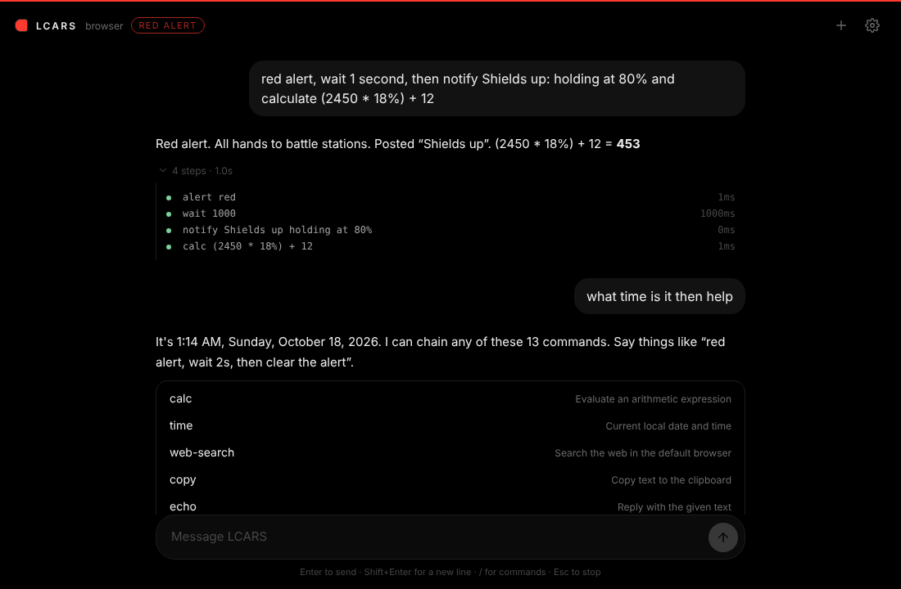

# LCARS Desktop Shell

A minimal, black, chat-first desktop shell built with **Tauri v2**, **Rust** and **Angular**. You type what you want, in plain words. LCARS turns it into one or more plugin commands and runs them in order. The reply is a short sentence, and the tool trace stays folded away until you ask for it.



## Highlights

- **Chat UI**: black, quiet and keyboard-first. Tool calls collapse into a single "4 steps · 1.0s" line. Results such as folders, apps and system facts render as compact, clickable cards.
- **Multi-step tasks everywhere**: "red alert, wait 2 seconds, then notify Shields up and stand down" runs as four ordered steps in the desktop app *and* in a plain browser.
- **Plugin registry**: every command is declared once in Rust (`src-tauri/src/ipc/registry.rs`) with plugin, aliases, summary and typed args. The CLI, the IPC pipe, the Tauri bridge and the chat agent all share it.
- **Hybrid brain**: a local planner handles everyday phrasing instantly and offline. If you add a Claude API key in settings, anything the planner can't parse goes to Claude, which can chain many tool calls.
- **Browser runtime**: when it runs outside Tauri, the app falls back to browser plugins (alert, notify, wait, calc, time, web search, open URL, clipboard) instead of failing.

## Architecture

- **Backend (`src-tauri/`)**: Rust 2021 + Tauri v2.
  - `ipc/registry.rs` holds the command catalog, alias resolution, "did you mean" hints, argument validation and the `batch` executor.
  - `ipc/handlers.rs` implements the commands.
  - `ipc/server.rs` serves the Windows named pipe, with one thread per client.
  - `ipc/commands.rs` exposes `run_command`, `run_batch` and `list_commands` to the UI.
- **Frontend (`frontend/`)**: Angular 20 with signals.
  - `core/planner.ts` turns natural language into ordered steps.
  - `core/runtime.service.ts` routes each step to Rust or to a browser plugin.
  - `core/agent.service.ts` drives the chat.
  - `core/claude.ts` is the optional Claude tool-use loop. It is lazy-loaded, so it costs nothing until it is used.

## Prerequisites

- [Node.js](https://nodejs.org/) (v18+) and npm
- [Rust](https://www.rust-lang.org/) (stable)
- Windows 10/11 with C++ Build Tools installed

## Building & Running

### Automated Pipeline
Run the full verification and build pipeline via PowerShell:

```powershell
.\pipeline.ps1
```

For release build with tests:
```powershell
.\pipeline.ps1 -Release -Tests
```

### Manual Development

1. **Frontend**:
   ```bash
   cd frontend
   npm install
   npm run start
   ```

2. **Tauri App**:
   ```bash
   cd src-tauri
   cargo build
   cargo run
   ```

## Chat

| You type | What runs |
| --- | --- |
| `show my desktop` | `list-dir` |
| `open notepad and notify Ready` | `start-app` → `notify` |
| `red alert, wait 2s, then stand down` | `alert` → `wait` → `alert` |
| `calculate (2450 * 18%) + 12` | `calc` |
| `/alert --mode yellow` | raw command syntax |

Keys: **Enter** sends, **Shift+Enter** adds a new line, **/** opens the command palette, **↑** recalls your last message, **Esc** stops a run and **Ctrl+K** starts a new chat.

The Claude API key is optional and is stored only in the app's local storage. Requests default to `claude-opus-5-5`. You can change the model in settings.

## CLI Usage

One executable is both the shell daemon and its control tool. Help and validation work without the daemon running.

```powershell
lcars-shell help                 # every command, grouped by plugin
lcars-shell help notify          # args for one command

lcars-shell alert red            # positional values fill declared args
lcars-shell notify "INCOMING TRANSMISSION" --body "Message from Starfleet Command"
lcars-shell open ~/Downloads
lcars-shell start-app notepad

# chain steps with then / + / ; / && into one batch request
lcars-shell alert red then wait 500 then notify "Shields up" then alert none
lcars-shell ping then bogus --continue    # keep going after a failed step

lcars-shell status --json        # raw JSON (default when output is piped)
```

Exit codes: `0` ok, `1` command failed or invalid, `2` daemon unreachable. Typos get a suggestion, for example `unknown command 'notfy' (did you mean 'notify'?)`.

## License

MIT / Proprietary (Configure as needed)
