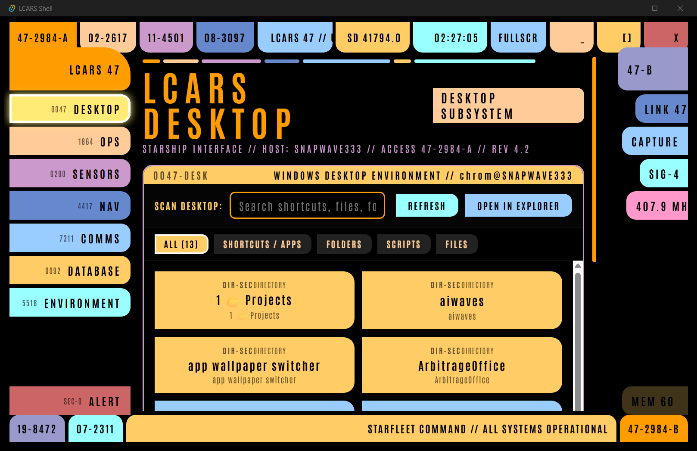

# LCARS Desktop Shell

A Star Trek LCARS-inspired Windows desktop environment and shell interface built with **Tauri v2**, **Rust**, and **Angular**.



## Overview

LCARS Desktop provides an authentic Library Computer Access and Retrieval System (LCARS) shell experience for Windows. It combines a high-performance Rust backend with a reactive Angular frontend, providing desktop system integration, IPC named pipes, CLI control, system monitoring, and customizable LCARS panels.

## Key Features

- **Authentic LCARS Interface**: Faithfully recreated LCARS design system with responsive SVG/CSS styling, sound effects, and color themes (Standard, Red Alert, Silent).
- **Daemon & CLI Control**: Built-in CLI client communicating over Windows Named Pipes (`lcars-shell hide`, `lcars-shell show`, `lcars-shell alert --mode red`, `lcars-shell notify`, etc.).
- **Windows Integration**:
  - System tray and taskbar management
  - Wallpaper detection and integration
  - Windows Run / Startup integration
  - Multi-monitor awareness
- **Modular Panels**:
  - System diagnostics and stats
  - Communications / Notifications
  - Audio and environment controls
  - Application launcher and custom functions

## Architecture

- **Backend (`src-tauri/`)**: Rust 2021 + Tauri v2, Tokio async runtime, Named Pipes IPC server, Clap CLI parser, Windows API bindings.
- **Frontend (`frontend/`)**: Angular 20, TypeScript, Tailwind/SCSS styling, RxJS state management.

## Prerequisites

- [Node.js](https://nodejs.org/) (v18+) and npm
- [Rust](https://www.rust-lang.org/) (stable)
- Windows 10/11 with C++ Build Tools installed

## Building & Running

### Automated Pipeline
Run the full verification and build pipeline via PowerShell:

```powershell
.\pipeline.ps1
```

For release build with tests:
```powershell
.\pipeline.ps1 -Release -Tests
```

### Manual Development

1. **Frontend**:
   ```bash
   cd frontend
   npm install
   npm run start
   ```

2. **Tauri App**:
   ```bash
   cd src-tauri
   cargo build
   cargo run
   ```

## CLI Usage

The executable acts as both the shell daemon and the command-line control tool:

```powershell
# Toggle visibility
lcars-shell toggle

# Trigger alert modes
lcars-shell alert --mode red
lcars-shell alert --mode yellow
lcars-shell alert --mode normal

# Send notification
lcars-shell notify --title "INCOMING TRANSMISSION" --body "Message from Starfleet Command"

# Daemon status & diagnostics
lcars-shell status
lcars-shell info
```

## License

MIT / Proprietary (Configure as needed)
