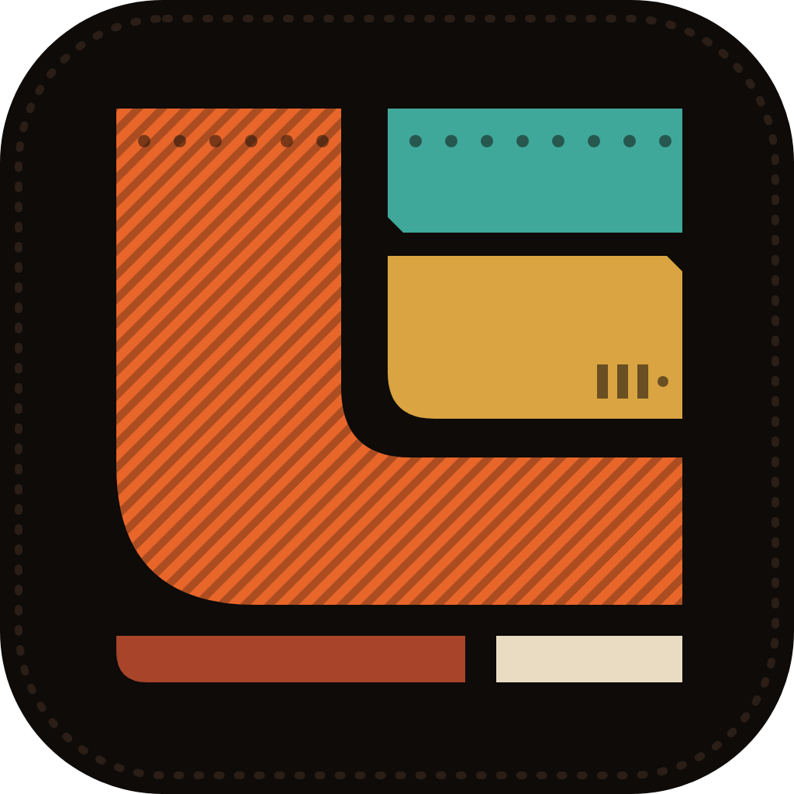
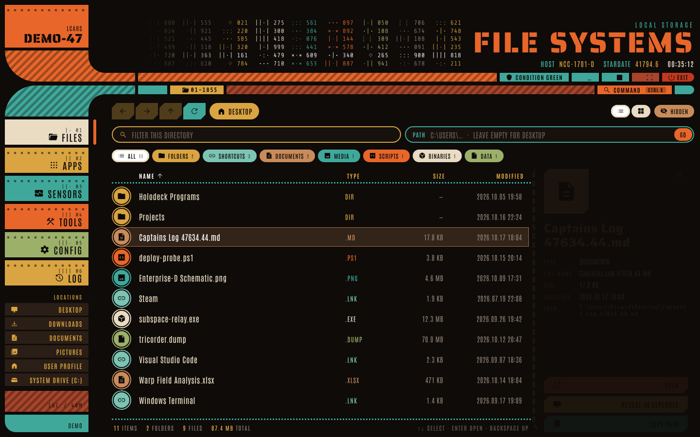
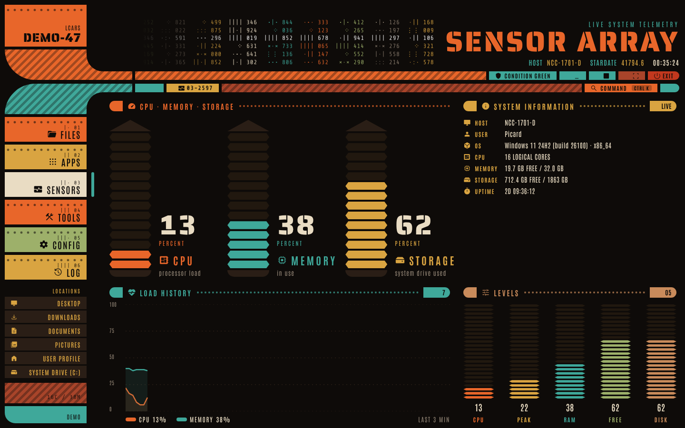
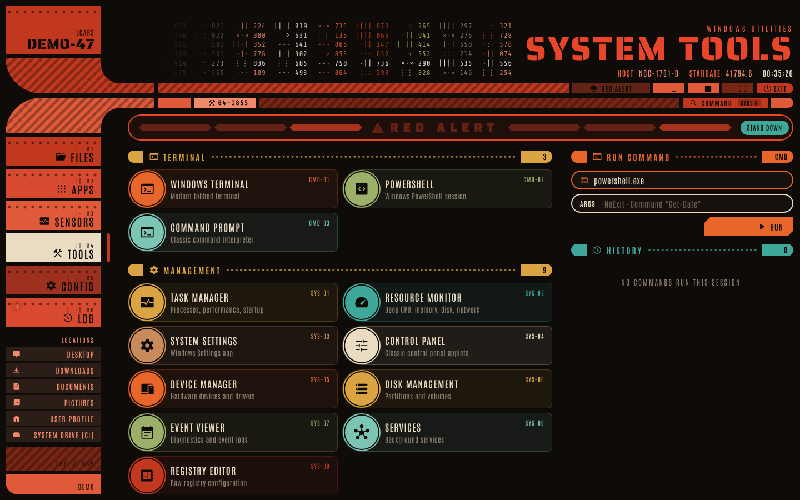
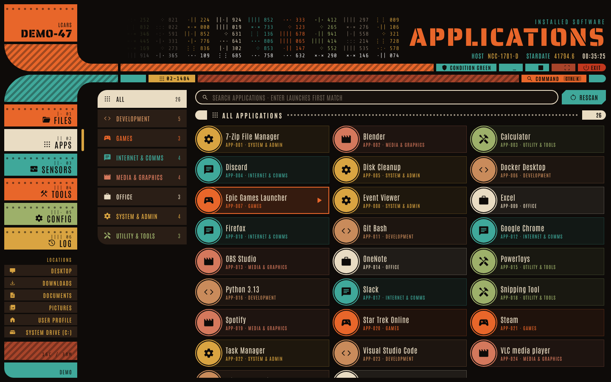
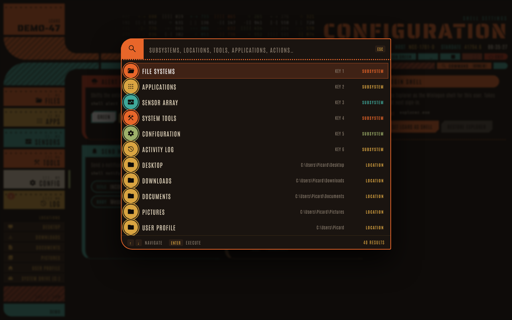

# LCARS Desktop Shell



A Star Trek LCARS-inspired desktop shell for Windows, built with **Tauri v2**, **Rust** and **Angular 20**.

The visual theme is **LCARS Remnant**: the console three hundred years after the Fleet went silent, rebuilt from hull plate, rivets and copper by the people who stayed behind. The LCARS layout and every standard Windows name are kept; only the surface has aged.



| Sensor array | Red alert |
| --- | --- |
|  |  |
|  |  |

## ✨ Features

- **LCARS Remnant theme**: double-elbow frame with woven elbows, riveted rail blocks, notched buttons, stacked-stone meters and a tally-mark data cascade. Ember, ochre, bone, patina, lichen and rust on a burnt-hull ground.
- **Icons and type**: Material Symbols Rounded throughout, a custom app icon (`docs/brand/app-icon.svg`), and Saira Stencil One, Antonio and Share Tech Mono bundled offline.
- **Alert conditions**: yellow, red and blue alerts recolor the whole frame.
- **File systems**: list and grid views, breadcrumbs, back/forward/up history, kind filters, sorting, hidden-file toggle, a details panel and full keyboard control.
- **Applications**: Start Menu and Desktop shortcuts are cataloged and cached, with categories, search and recent launches.
- **Sensor array**: live CPU, memory and storage totems, a rolling load chart and level meters, all driven by real Win32 telemetry.
- **Engineering**: one-click Windows tools plus a direct execution console with quote-aware arguments and history.
- **Configuration**: alert conditions, start with Windows, Winlogon shell replacement (with a confirm step) and notifications.
- **Command palette** (`Ctrl+K` or `/`): fuzzy search across subsystems, locations, tools, apps and alerts.
- **CLI and daemon**: the same executable controls a running shell over a named pipe.

## 🏗️ Architecture

```
src-tauri/src
├── main.rs            entry: CLI client or GUI daemon
├── cli.rs             named-pipe client (`lcars-shell <command>`)
├── ipc/
│   ├── handlers.rs    single command router shared by the pipe and the webview
│   ├── commands.rs    async Tauri commands (run off the UI thread)
│   ├── protocol.rs    newline-delimited JSON request/response
│   └── server.rs      \\.\pipe\lcars_cli server
└── platform/          OS integration, no Tauri dependency
    ├── fs.rs          typed directory listings and quick locations
    ├── apps.rs        Start Menu scan with category table and cache
    ├── telemetry.rs   CPU (GetSystemTimes), memory, disk, uptime, wallpaper
    ├── shell.rs       ShellExecuteExW open/launch, Explorer reveal, autostart, Winlogon
    ├── registry.rs    RegGetValueW / RegSetKeyValueW helpers
    └── window.rs      foregrounding and PrintWindow capture

frontend/src/app
├── core/              backend abstraction and signal stores
│   ├── backend.ts     Backend interface + BACKEND token
│   ├── tauri-backend.ts / demo-backend.ts
│   ├── system.store.ts, files.store.ts, apps.store.ts, log.store.ts, settings.store.ts
│   └── format.ts      pure formatting and path helpers
├── layout/            data cascade, toasts, command palette
├── shared/            icon, totem meter, trend chart
└── features/          lazily loaded routes: files, apps, sensors, tools, config, activity
```

The frontend is zoneless, uses OnPush and signals throughout, and lazy-loads each subsystem. Opening it in a plain browser (`npm start`) uses the **demo backend** with a simulated starship, so the UI can be developed and tested without Windows or Tauri.

## 🚀 Building

Prerequisites: Node.js 22+, Rust stable, and Windows 10/11 with the C++ build tools.

```powershell
.\pipeline.ps1            # build frontend + backend, CLI smoke test
.\pipeline.ps1 -Release -Tests
```

Manual:

```bash
cd frontend && npm ci && npm start      # UI with demo data at http://localhost:4200
cd src-tauri && cargo run               # full desktop shell (Windows)
```

## 🧪 Testing

```bash
cd frontend
npm test            # Karma unit/integration tests (ChromeHeadlessCI)
npm run e2e         # Playwright end-to-end tests against the demo backend
cd ../src-tauri
cargo test          # Rust unit tests
```

Icons are generated from `@material-symbols/svg-400`; add a name to `scripts/icons.mjs` and run `npm run icons`. The app icon set is generated from `docs/brand/app-icon.png` with `npx tauri icon ../docs/brand/app-icon.png -o ../src-tauri/icons`.

## ⌨️ CLI

```powershell
lcars-shell help
lcars-shell toggle
lcars-shell alert --mode red          # red | yellow | blue | normal
lcars-shell notify --title "INCOMING TRANSMISSION" --body "Message from Starfleet Command"
lcars-shell ls --path C:\Users
lcars-shell launch --path wt.exe
lcars-shell auto-start --enable true
lcars-shell status
```

Exit codes: `0` success, `1` command failed, `2` daemon unreachable.

## License

MIT
